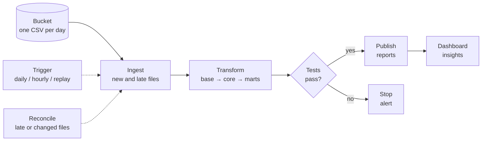
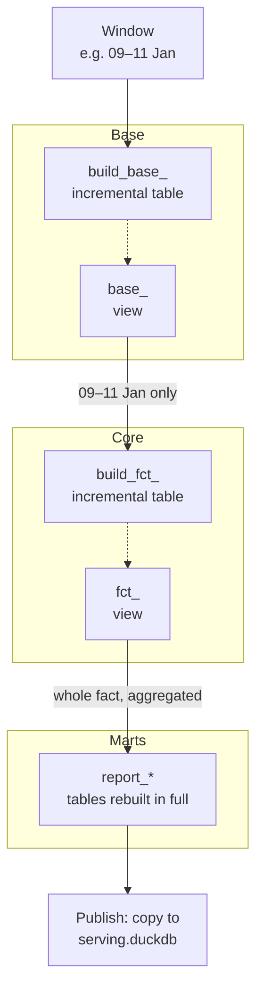

# UpCloud Engineering Task - E2E Pipeline Planning

This is the plan written before the implementation, updated where the implementation changed it.
How to run the repo, and the details of each step, are in the [README](README.md).

# Framework selection rationale

To choose the right tools, I first looked at what the task requires. The deliverable is a data pipeline that:

* Ingests billing data from the defined S3 bucket
* Performs transformations upon the data
* Applies GDPR procedures for PII before exposing any data
* Aggregates it by relevant dimensions
* Outputs insights such as sums and averages on key metrics

Given this deliverable, I need a framework that is able to:

* Connect with an S3 bucket and read Hive-partitioned data automatically, this is key (I do not want the loading step to become a separate process)
* Trigger an ingestion (that my personal laptop can handle) and that can mimic a daily ingestion
* Give me the flexibility to perform backfills and be aware of gaps in my data
* Let me manipulate and transform the raw data coming from the ingestion process so that I can create data products that are capable of answering relevant business questions
* Run lightweight and fast so I can test and rerun the pipeline locally as often as needed
* Expose the final reports/data models in a lightweight dashboard for tracking basic credit usage metrics and basic ingestion process monitoring

## Framework Decisions

| Requirement / Brainstorm Point | Chosen Solution                          |Why                                                                                                  |
| ------------------------------ | ---------------------------------------- | ---------------------------------------------------------------------------------------------------- |
| Ingestion                      | DuckDB (`httpfs` extension)              | Reads Hive-partitioned CSVs directly over HTTPS with no cloud infrastructure and runs fast on a laptop. |
| Data Transformations and Preprocessing | `dbt`                            | Tons of flexibility for setting up an out-of-the-box data warehouse with all its layers, straightforward data source connection methods, applying complex data transformations using SQL, built-in methods for handling incremental modelling and model documentation |
| Local Execution                | `dbt-duckdb` adapter (local DuckDB file) | Lightweight and quick to rerun as often as needed, with no always-on infrastructure.                 |
| Orchestration & Backfilling    | Python script (`scripts/run_pipeline.py`) + `make` targets | Light local execution that handles daily runs, backfills, simulated replays and reconciles with the same models. |
| Insights                       | Streamlit dashboard                      | Reads a published snapshot of the marts and ingestion-quality data. Refreshes itself when a new one lands.                   |
| Data Catalog & Lineage         | dbt Docs (`schema.yml`, `column_catalog/`) | Out-of-the-box lineage and column-level documentation, hostable as a static site for stakeholders.   |

## Why DuckDB

* **Reads the source directly:** Hive-partitioned CSVs straight from the bucket, no separate loader
* **No server:** `pip install`, one file, free. Anyone can run `make demo`
* **Works with dbt:** Incremental models, tests and docs via `dbt-duckdb`

**Why not the others**
* Postgres and ClickHouse need a server (and Postgres is slow at analytics)
* Spark is built for clusters
* pandas/Polars have no warehouse or dbt
* BigQuery/Snowflake are paid cloud services
* Hosting on UpCloud was an alternative, but DuckDB proved straightforward, quick and ready for testing

# Technical Aspects of the Requirements

### Full idempotency in the Pipeline

* Idempotency refers to re-run scenarios: if the pipeline is accidentally run five times in a row, the result in the destination is identical to running it once.
* This is achieved with dbt's `incremental_strategy='delete+insert'`, keyed on the day (`partition_date` in base, `billed_at` from core on), in every layer: a run deletes its window's days and inserts them again.
* For amending data gaps, each backfill run retrieves and replaces the data for the affected partitions instead of appending to it. Reprocessing a day never creates duplicates.

### Ingestion Failure Protocols

* **How can I handle bucket paths with no daily file?**
    * Testing the connection in a separate Jupyter notebook showed that the bucket does not allow listing, and that one missing file makes DuckDB's `read_csv` fail.
    * **Workaround for an automated ingestion:** check which files/days are available first, and only then build the bucket paths to fetch the data. A connection attempt that gives me a `404` is skipped and logged as a gap, any other error aborts the run.
* **What if file corruption is discovered or data arrived late to the bucket?**
    * A script that compares the bucket with the file manifest and reloads days that arrived late, were never loaded, or changed (new ETag) would come in handy. In a production scenario failures in the bucketing process could happen and my pipeline must be capable of recovering and reprocessing any corrupted or missing data
    * Daily runs also reload the 2 previous days (lookback), in case an incident delayed or corrected recent files.

* **Data Quality Assurance**
    * `unique` and `not_null` tests on PKs and other critical fields relevant to credit usage tracking run on the `build_` model of every layer, scoped to the run's window.
    * A failing test makes `dbt build` skip everything downstream and nothing is published, so the core and marts never build on bad rows and whatever figures or metrics I'm exposing stay unaffected, because the last healthy snapshot stays published
    * The last thing I want is for the credit usage figures to be duplicated thanks to a silent error in any of my dwh layers. I prefer things to fail loudly and without disrupting daily usage monitoring
* **Freshness**
    * As the owner of the process I need to be able to check ingestion health every morning and notify my stakeholders in the designated notifications channel that yesterday's credit usage has not been ingested yet and that I'm on it
    * The way that I would display ownership is to be proactive and be aware of any possible errors/delays before my stakeholders notice the data gaps in their reports

### Daily Ingestion Simulation Setup

The source is static (files stop at 2026-01-11), so I would want the option to replay it as if it were arriving day by day.

**1. Simulated clock:** the window is computed from the `exec_date` variable instead of the real clock. Setting it to a past date makes the run behave as if that day were "today".

**2. Two-phase replay**

* **Historical Backfill Option:** I want to be able to reprocess any data within a specific date range
* **Daily Replay:** I want to be able to simulate a scenario where my pipeline ingests new daily files it detects

**3. Run log:** every run updates the file manifest (`ops__ingestion.billing_file_manifest`: status, ETag and load time per daily file), and every reconcile writes to `ops__ingestion.reconcile_log`. Both are shown on the Data health page.

### Lineage

* Model level: the dbt docs lineage graph
* File level: the file manifest
* Row level: `source_file` and `dbt_invocation_id` on every base row, so that I can trace a row back to the run that loaded it.

### Sensitive data (GDPR)

* `user_id` could qualify as PII, so it is hashed with a salted `sha256` in the base layer and the raw value never reaches the warehouse (important for a warehouse with wide reach, used across the enterprise)

# How I want the pipeline to run

| Finding | Action |
|---|---|
| File arrived late, or was never loaded | Load it |
| File changed (new ETag) | Reload the day |
| File disappeared | Keep the data, flag it on the Data health page |

# dbt Layer Specifics, Definitions and Best Practices

| Layer | Purpose |
|---|---|
| Base | Reads raw files, renames, casts types, pseudonymises `user_id`, adds lineage columns. No business logic |
| Core | Fact table and location dimension: credits consumed, location resolved to country |
| Marts | Business-facing daily reports (finance and client usage) the dashboard reads |

# Incremental modelling

Every layer only reprocesses the days in the run's window (yesterday plus a 2-day lookback, or the
backfill / reconcile range). Each row belongs to exactly one day and each daily aggregate only
depends on that day's rows, so a day can be rebuilt on its own: `delete+insert` keyed on the day
replaces it without touching the rest of the history.

**One stored table per layer.** The `build_` model holds the data and the tests, the model without the prefix is a view over it, the stable name downstream models and the dashboard read.
