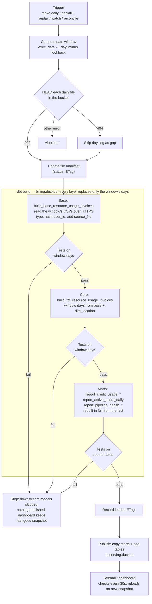

# UpCloud Billing Data Pipeline

Loads UpCloud's daily billing files into a local DuckDB warehouse with dbt, models them into reporting
tables, and shows the results in a Streamlit dashboard that updates itself as new files arrive.

Design decisions and how the pipeline works internally: [PLANNING.md](PLANNING.md).

# Pipeline components and how each requirement is addressed

| Requirement | How |
|---|---|
| Ingest Hive-partitioned CSVs | DuckDB reads the daily files straight from the bucket |
| Preprocess | dbt base layer: types, cleans, splits region into country/city, hashes `user_id` |
| Aggregate | dbt marts: daily reports by country, resource, tier, operation, and by client |
| Insights (sums, averages) | dbt insight marts: credit usage per day, month and year (sliceable), by country, active users, pipeline health |
| Insights shown | Streamlit dashboard: reads the insight marts as they are, no metric logic in Python |
| New files are picked up | Each run checks which files exist and loads them; `make watch` runs hourly, `make reconcile` catches late or changed files |
| Insights update dynamically | After tests pass, the marts are published to `serving.duckdb` and the dashboard reloads within 30 s |
| Documentation before code | [PLANNING.md](PLANNING.md), written before the implementation |
| Light, open-source tools | DuckDB, dbt, Streamlit, Python. No cloud services |
| *Bonus:* idempotency | Each day is replaced (delete+insert), never appended: re-runs never duplicate |
| *Bonus:* data catalog | dbt docs with column documentation (`make docs`) |
| *Bonus:* lineage | Model graph (dbt docs), file versions (manifest), source file and run id on every row |
| *Bonus:* GDPR | `user_id` pseudonymised with a salted hash (see [Sensitive data](#sensitive-data-gdpr)) |

# Quick start

Requirements: Python 3.10+, `make`, internet access.

```bash
make demo
```

Sets up `.venv`, loads Dec 2025 to Jan 11 2026, runs all models and tests, and opens the dashboard at
http://localhost:8501. The first run takes about 10 minutes (mostly downloading files).

| Command          | When to use it                                                                                     |
| ---------------- | -------------------------------------------------------------------------------------------------- |
| `make demo`      | First time here: installs, loads Dec 2025 to Jan 2026 and opens the dashboard                      |
| `make daily`     | The normal daily run: loads yesterday and reloads the 2 days before (as of `EXEC_DATE`, default 2026-01-12) |
| `make reconcile` | **The bucket decides.** Reloads files that arrived late, were never loaded, or were corrected at the source. `make reconcile-dry` only shows what it would reload |
| `make backfill`  | **You decide.** Reloads the days you pass, whatever the reason: `START=2025-12-05 END=2025-12-05` for one day (files exist 2022-01-01 to 2026-01-11) |
| `make watch`     | Keep it running: a daily run every hour plus one reconcile per day. Ctrl+C to stop                 |
| `make replay`    | Demo only: pretend one new file arrives per step (2026-01-06 to 01-12)                             |
| `make publish`   | Refresh what the dashboard reads, without loading anything                                         |
| `make dashboard` | Start the dashboard only                                                                           |
| `make docs`      | dbt docs: model and column descriptions, lineage graph                                             |
| `make clean`     | Delete `.venv` and all local databases, to start from scratch                                      |

**See it update live:** `make backfill END=2026-01-04`, then `make dashboard` in one terminal and
`make replay` in another.

# How it runs



In base and core, each `build_` model is an incremental table (`delete+insert` keyed on the day), so
a daily run only touches the days in its window, not the whole history. The model without the
prefix (`base_resource_usage_invoices`, `fct_resource_usage_invoices`) is a view over it: one stored
copy per model. The marts' reports are plain tables: small aggregates of the fact, rebuilt in full on
every run (under a second each). Every report reads the fact table, never another mart.
Why, in [PLANNING.md](PLANNING.md#incremental-modelling).

# Project layout

```
├── Makefile, requirements.txt   setup and run commands
├── scripts/run_pipeline.py      runner: checks files, runs dbt, publishes
├── notebooks/                   initial data exploration
└── upcloud_billing_dwh/         dbt project
    ├── models/base/             raw files, typed and cleaned
    ├── models/core/             fact table and location dimension
    ├── models/marts/            reporting tables for the dashboard
    ├── column_catalog/          column documentation
    ├── seeds/                   data centre and country mapping
    ├── macros/                  date window, file URLs, test filters, schema names
    └── dashboard/               Streamlit app
```

# Business Rules

* **Credits charged** = credits of successful transactions; **credits uncharged** = credits of failed ones. Defined once, as two columns of `fct_resource_usage_invoices`: every report sums them.
* **Active user** = at least one transaction in the period, successful or not.
* **Latest data is always yesterday**: files arrive once a day.

# Lineage

* **Models:** `make docs` shows the lineage graph.
* **Files:** the file manifest records which version (ETag) of each daily file was loaded.
* **Rows:** each base row has `source_file` and `dbt_invocation_id` (the dbt run that loaded it).

# Sensitive data (GDPR)

* `user_id` could qualify as PII. It is hashed with a secret salt (`BILLING_PII_SALT`) in the base layer, so the raw value is never stored.
* `invoice_id` and `resource_id` are kept as-is: they don't identify a person on their own, and are needed to trace charges.
* This is pseudonymisation, not anonymisation: whoever has the salt can link a hash back to a known user.

Changing the salt changes every `user_id`, so rebuild from scratch: `make clean && make demo`.

# For Developers - Querying the Database

Changed a dbt model and want to check the data?

Run the following command to open the DuckDB UI, where you can query any table the local pipeline runs have built in `billing.duckdb`. It needs the DuckDB command-line tool, version 1.2 or later (for example `brew install duckdb`); `requirements.txt` only installs the Python package.

```bash
duckdb -ui upcloud_billing_dwh/billing.duckdb
```

For example:

```sql
select *
from marts__domain_finance.report_credit_usage_daily
where country = 'All' and resource_type = 'All' and service_tier = 'All' and operation_type = 'All'
order by billed_at
```

Close the session (`.quit`) before running the pipeline: an open connection blocks it.

# The dashboard

| Page                      | Shows                                                                                              | dbt model(s)                                                                  |
| ------------------------- | -------------------------------------------------------------------------------------------------- | ----------------------------------------------------------------------------- |
| **Credit usage, daily**   | Latest day: credits charged and uncharged, transactions (successful, failed, rate), active users; credits per day with a 7-day average; usage by country | `report_credit_usage_daily`, `report_credit_usage_by_country_daily`, `report_active_users_daily` |
| **Credit usage, history** | The same metrics per day, month or year, with partial periods marked                              | `report_credit_usage_daily`, `_monthly`, `_yearly`                            |
| **Pipeline health**       | Last day loaded, files loaded / missing / changed since loading, rows loaded per day               | `report_pipeline_health_daily`                                                |

Both credit pages can be sliced by country, resource type, service tier and operation type (one value each, or All).
Credits are always shown in millions (1 billion = 1,000.0M cr).

**Every metric is defined in dbt, not in the dashboard.** The credit models use
`group by <period>, cube(country, resource_type, service_tier, operation_type)`, which stores a row for every
combination of the four dimensions plus an 'All' total for each, with its own failure rate. The dashboard only
runs `select ... where country = ? and ...`: changing a metric is a change to a dbt model, with its docs and tests.

# Data observations

* Failure rate is a flat 5% across every dimension (country, tier, resource, operation, hour).
  No segment is more failure-prone than another.
* Finland has twice the volume (because it has two data centres in Helsinki), not more demand.
* Per data centre, volume is the same everywhere. Country totals hide this, so a country comparison should be normalised per data centre.
* Service tier belongs to the transaction, not the user. Every user uses all four tiers, and credits split about 25% per tier. Tier can't segment customers ("premium users"), only usage.
* Clients are nearly identical (about 6% spread in usage). No real conclusion can be drawn when doing a ranking per client per usage.
* Usage looks uniform across the six data centres at day level. There is no daily peak or regional hotspot.
* `resource_id` is unique per transaction and acts as a transaction key, not a long-lived resource, so the data can't support lifecycle metrics (resource age, uptime, cost per server).
